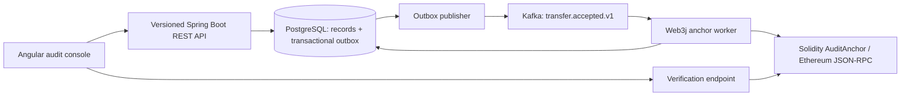
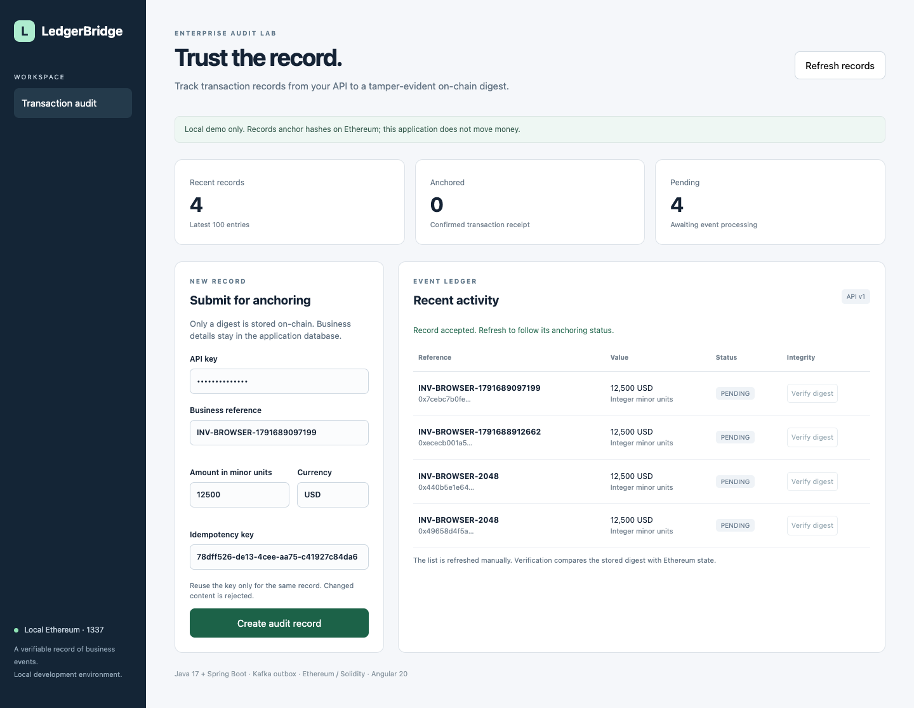

# LedgerBridge

A Java, Kafka, Ethereum, and Angular portfolio project for **tamper-evident enterprise transaction auditing**.

LedgerBridge accepts a business transaction record, persists it together with an outbox event, publishes the event to Kafka, and writes its digest to a Solidity contract through Web3j. An Angular console follows pending and anchored records and verifies their stored digests against Ethereum state.

**This project does not transfer money, provide a wallet, or implement a brokerage.** It uses a disposable local Ethereum chain. Business references and amounts stay off-chain; only a record identifier and SHA-256 digest are anchored.

## Architecture



### What is implemented

- Java 17 / Spring Boot 3.5 REST endpoints with request validation, integer minor-unit amounts, API-key protection, and idempotency keys.
- PostgreSQL-compatible JDBC persistence and a transactional outbox. H2 PostgreSQL mode supports local API tests and the embedded-broker integration test.
- Kafka publishing, row locking across publisher replicas, at-least-once consumption, retries, and duplicate-safe contract calls.
- Web3j ABI encoding, local wallet signing, transaction-receipt checks, and on-chain digest reads. The writer refuses non-local chain IDs.
- Solidity writer authorization, immutable record digests, conflict rejection, and replay without another anchor event.
- Angular 20 standalone components, typed records, reactive status counts, form validation, responsive layouts, error feedback, and digest verification.
- Docker infrastructure configuration, a non-root backend Dockerfile, and GitHub Actions verification.

## Local prerequisites

- Java 17+, Maven, Node.js 22.12+ (Node 22 LTS recommended), and npm.
- Docker for the PostgreSQL/Kafka development stack. Docker is **not required** for the API, Solidity, or embedded-Kafka integration tests.

## Run the application

From the repository root:

```bash
npm ci
npm ci --prefix frontend
npm run chain
```

Keep the chain terminal open. In a second terminal:

```bash
npm run deploy
```

Deployment writes `deployment/local.json` and `deployment/backend.env`, both ignored by Git. They contain a publicly known, disposable development account. Never send real assets to this account or use it for production.

For the persistent database and Kafka broker:

```bash
docker compose up -d
```

In a third terminal, configure the backend and run it:

```bash
set -a
. deployment/backend.env
set +a
export DB_URL=jdbc:postgresql://localhost:5432/ledger
export DB_USER=ledger
export DB_PASSWORD=local-development-only
export KAFKA_BOOTSTRAP=localhost:9092
export LEDGER_EVENTS_ENABLED=true
export LEDGER_API_KEY=local-demo-key
mvn -f backend/pom.xml spring-boot:run
```

In another terminal:

```bash
npm start --prefix frontend
```

Open `http://localhost:4200`. Enter the API key, create a record, refresh after processing, then select **Verify digest**. A pending record is not evidence of successful blockchain anchoring.

### Lightweight API-only mode

```bash
mvn -f backend/pom.xml spring-boot:run
```

Without environment overrides, the backend uses an in-memory H2 database and disables event delivery. Records remain `PENDING`. This mode validates the API and UI, not the complete Kafka/blockchain pipeline.

## API examples

```bash
curl -X POST http://localhost:8080/api/v1/transfers \
  -H 'Content-Type: application/json' \
  -H 'X-API-Key: local-demo-key' \
  -H 'Idempotency-Key: invoice-2048' \
  -d '{"reference":"INV-2048","amountMinor":12500,"currency":"USD"}'

curl http://localhost:8080/api/v1/transfers \
  -H 'X-API-Key: local-demo-key'
```

Use the returned `id` with `GET /api/v1/transfers/{id}` or `GET /api/v1/transfers/{id}/verify`. Reusing a key with identical content returns the same record. Reusing it with different content returns `409`. Invalid fields return `400`; missing or invalid API keys return `401`.

The UI displays **integer minor units**, rather than assuming every currency has two decimal places. Currency syntax is validated; ISO currency membership and currency exponent lookup are not implemented.

## Validation

```bash
npm run test:contracts
mvn -f backend/pom.xml test
npm run build --prefix frontend
```

The real local-chain integration test starts its own embedded Kafka broker and uses H2. With `npm run chain` running and the contract deployed:

```bash
set -a
. deployment/backend.env
set +a
mvn -f backend/pom.xml test -Dblockchain.it=true
```

With the API-only backend and UI running, optional browser checks can be reproduced with:

```bash
npx playwright install chromium
npm run test:ui
```

Set `PLAYWRIGHT_CHROMIUM_EXECUTABLE` to an installed Chrome executable to use that browser instead. Screenshots are saved under `docs/`.

See [docs/VALIDATION.md](docs/VALIDATION.md) for **observed** results and limitations. Test counts describe executed test cases, not code coverage or production performance.

## Failure behavior and tradeoffs

- **Database write fails:** record and outbox insert roll back together.
- **Kafka unavailable:** the outbox row stays unpublished and the scheduler retries. Publishing blocks for a bounded acknowledgement timeout.
- **Crash after Kafka acknowledgement:** an event can be published twice. The on-chain operation is idempotent for an identical digest.
- **Crash after anchoring but before database update:** retry reads the existing on-chain digest and marks the record anchored. A transaction hash can remain absent in this recovery path; it is not fabricated.
- **Different digest for the same key:** rejected by both application idempotency validation and the contract.
- **Invalid contract address / RPC unavailable:** processing retries and the record stays pending. Infinite retry is appropriate only for this small demo; a production system needs bounded retries, a dead-letter workflow, alerts, and operator recovery.
- **Reorganizations:** the local test treats a mined receipt as confirmation. Production confirmation depth, reorganization reconciliation, and event indexing are not implemented.

## Security and scope

The API key is a single-user demonstration credential, not multi-tenant authentication. The browser key is entered locally and kept only in component memory. Production deployment would require user authentication, RBAC, HTTPS, managed signing keys, scoped identities, audit-log retention, database migrations, rate limits, and operational monitoring. Only `/actuator/health` is exposed by Actuator.

On-chain hashes are not a substitute for confidentiality or proof that business facts are true. Low-entropy records can be guessed; a production design may need salted commitments and a privacy review. Off-chain rows are trusted by this demo's verification endpoint, which compares the stored digest with chain state. No production deployment, benchmark, or security audit is claimed.

## Job relevance

This demonstrates Java/Spring Boot APIs, Angular integration, Kafka event delivery, local Ethereum smart-contract interaction, data integrity, and container/CI workflows. It does not claim Hyperledger Fabric, Polygon, Binance Smart Chain, production blockchain operations, or professional blockchain experience.

## References

- [Web3j contract interaction](https://docs.web3j.io/latest/getting_started/deploy_interact_smart_contracts/)
- [Solidity documentation](https://docs.soliditylang.org/)
- [Spring Kafka documentation](https://docs.spring.io/spring-kafka/reference/)
- [Angular documentation](https://angular.dev/)

## Console preview


